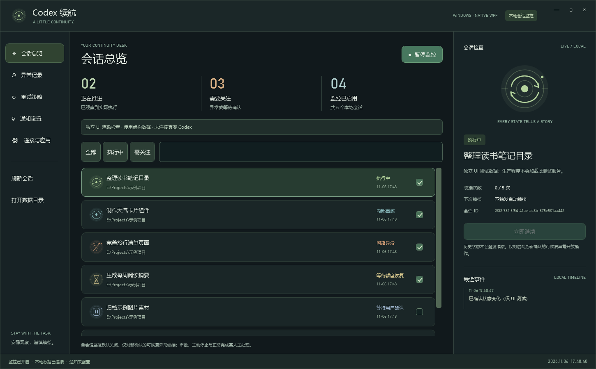
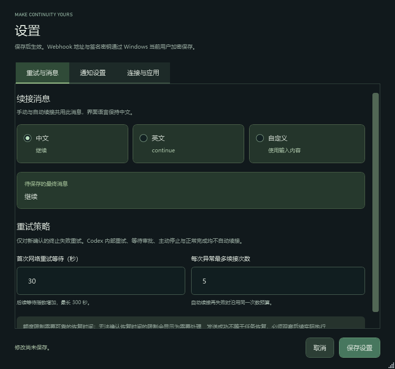

# Codex Auto Continue（Codex 自动续接）

面向 Windows 的 Codex 桌面辅助程序，提供暗黑会话面板、可恢复异常的续接调度、Webhook 通知和自动升级。

**当前版本：0.2.1-preview，Windows 桌面测试版。** 已实现本机 Codex Desktop 会话读取、恢复策略、消息发送器、通知、持久化、EXE 打包与空闲自动升级。**当前机器的桌面后端没有暴露已验证的控制端点，因此尚未验证桌面任务能够自动恢复，不能保证无人值守续跑。** CLI 接受消息只会显示“待确认”，观察到真实执行后才确认恢复。

## 运行与构建

[下载便携 ZIP](https://github.com/tvcmall-dev/codex-auto-continue/releases/download/v0.2.1-preview/CodexAutoContinue-0.2.1-preview-win-x64.zip) · [单独下载 EXE](https://github.com/tvcmall-dev/codex-auto-continue/releases/download/v0.2.1-preview/CodexAutoContinue.exe) · [版本说明与校验值](https://github.com/tvcmall-dev/codex-auto-continue/releases/tag/v0.2.1-preview)

- Windows 10/11 x64，.NET Framework 4.8。
- 便携包解压后运行 `CodexAutoContinue.exe`，无需管理员权限。
- 从源码构建需要 .NET SDK 与 .NET Framework 4.8 Developer Pack，在仓库根目录运行 `./build.ps1`。
- 构建脚本先运行测试，再在 `dist` 中生成 EXE 便携目录与 ZIP。
- 无第三方运行时包依赖；SQLite 使用系统自带的 `winsqlite3.dll`，无需 Node.js、Python 或单独的 API Key。

完整操作步骤、状态说明及排查方式见[使用说明](docs/使用说明.md)。

## 已实现功能

以下为程序界面截图，图中使用明确标记的虚构测试数据；正式启动不会加载示例会话。



- 暗黑三栏面板、矢量状态插画、搜索筛选、会话详情和事件记录；启动后默认显示“执行中”，可切换“全部”或“需关注”。
- 读取最近 120 个未归档的本机桌面主会话；排除子会话与扩展来源。
- 单会话监控默认关闭，可分别开启；提供全局暂停、关闭到托盘和可选开机启动。
- 中文（默认 `继续`）、英文（`continue`）、自定义续接消息；保存后统一用于手动与自动续接。
- 仅对监测后新确认的可恢复终态失败调度；默认 30 秒起指数等待，最多 5 次，后续自动失败沿用同一次异常的次数。
- 发送前持久化并重新检查目标；不确定的投递保持待确认，重启后核对实际终态，防止重复消息。
- 钉钉、飞书、企业微信和通用 Webhook；支持平台签名、真实手动测试、事件订阅、去重与最多 3 次投递。
- SQLite 保存状态与历史；完整 Webhook URL 和密钥使用 Windows 当前用户 DPAPI 加密。
- 启动及每 6 小时检查新版本，自动下载并校验 SHA-256，程序空闲时重启安装，启动检查失败时回退。



## 自动升级

**0.1.0-preview 尚无自动升级能力，需要先手动安装一次当前版本 0.2.1-preview。** 从托盘退出旧程序后，将新 EXE 或解压后的便携包覆盖到原目录；设置和监控记录保存在用户数据目录，可继续使用。0.2.0-preview 用户可继续使用“应用升级”检查并安装本版。

新版本默认启用自动检查、自动下载和空闲安装，只从固定的 [tvcmall-dev/codex-auto-continue GitHub Releases](https://github.com/tvcmall-dev/codex-auto-continue/releases) 获取更新。启动时检查一次，运行期间每 6 小时检查一次；下载通过 SHA-256、文件大小及程序版本校验后才等待安装。默认接收预览版，可在“设置 → 应用升级”改为只接收正式版，也可关闭自动检查或自动安装。希望完全手动控制时，关闭这两个开关并保存。

打开设置、刷新会话、发送消息、投递通知或测试 Webhook 时会延迟重启；全局与会话监控均开启且仍有待续接计划时，即使计划尚未到时间，也会等待。待确认的投递状态会保存，重启后继续核对，避免重复发送。

安装只替换程序 EXE，在原目录保留 `CodexAutoContinue.exe.previous` 作为上一版本备份。新进程需在 20 秒内通过启动检查，否则尝试回退并重启上一版本；失败版本进入 24 小时自动升级冷却期。检查或下载失败不影响监控，可在升级页手动重试。程序目录需可写，不会请求管理员权限。详细操作与故障恢复见[使用说明](docs/使用说明.md)。

## 真实接入边界

当前适配器只读 Codex 自己维护的 `state_*.sqlite` 和 `thread_history_*.sqlite` 事件投影。启动先建立基线，历史失败不会自动重发。首次读取时，如果同一轮次仍为 `inProgress`，且最近 2 分钟内有真实输出或已完成工具执行，可显示“执行中”；这一初始显示线索不会确认自动续接成功。单独的历史 `inProgress` 记录不足以证明仍在运行；超过 2 分钟没有新执行证据时会转为待确认，不因此触发续接。

本版修复轮次开始时间使用秒、同轮用户消息使用毫秒时造成的状态显示延迟，避免开始事件被误当作旧事件过滤；新轮次不必等到首条输出后才显示为“执行中”。

续接使用现有认证的 `codex queue --thread <ID> --message <内容> --resume`，保持原会话身份。当前 Windows 桌面后端以 stdio 运行，未找到可连接的现有控制端点；CLI 可能提示恢复失败但仍返回 0。因此，入队、退出码和新轮次开始均不代表已恢复，程序必须等到实际执行证据。

额度或速率限制如果没有可靠重置时间，会转为人工关注。内部重试、审批等待、主动停止、正常完成、鉴权或余额等异常不会触发重复续接。程序不会修改 Codex 数据库、认证或全局钩子配置。

## 验证

```powershell
dotnet build tests/CodexAutoContinue.Tests/CodexAutoContinue.Tests.csproj -c Release
.\tests\CodexAutoContinue.Tests\bin\Release\net48\CodexAutoContinue.Tests.exe
.\src\CodexAutoContinue\bin\Release\net48\CodexAutoContinue.exe --smoke-test
powershell.exe -NoProfile -File .\tests\Verify-UpdateIntegration.ps1
powershell.exe -STA -NoProfile -File .\tests\Verify-ActiveView.ps1
```

测试包括恢复状态机、真实格式数据库读取、发送前重查、防重复与重启核对、消息指纹、DPAPI、SQLite、平台签名和 HTTP 200 业务失败，也覆盖版本选择、下载完整性、空闲升级条件、EXE 替换与回退。Webhook 自动测试使用内存 HTTP 处理器，不向真实机器人投递；真实测试通知由用户在设置中主动触发。

独立进程升级验证需要 64 位 Windows PowerShell 5.1，并要求先退出正在运行的本程序。脚本在临时目录创建隔离安装，验证程序启动回执、备份、失败回退、24 小时冷却及设置/SQLite 数据保留；仅清理本次测试创建的进程和文件。

执行中视图验证使用虚构会话，检查默认筛选、状态切换、快照复用和刷新合并；不会显示窗口或占用正在运行程序的互斥锁，可与正常监控同时运行。

## 项目结构

| 路径 | 内容 |
| --- | --- |
| `src/CodexAutoContinue/Desktop` | 原生界面与托盘 |
| `src/CodexAutoContinue/Core` | 恢复状态机与失败分类 |
| `src/CodexAutoContinue/Integration` | 本地读取与 CLI 投递 |
| `src/CodexAutoContinue/Infrastructure` | SQLite、DPAPI 设置与状态持久化 |
| `src/CodexAutoContinue/Notifications` | 平台消息与签名 |
| `src/CodexAutoContinue/Updating` | 固定来源检查、下载校验、空闲安装与回退 |
| `tests/CodexAutoContinue.Tests` | 无外部服务依赖的行为测试 |

最初的[交互原型](docs/prototypes/dashboard.html)保留为设计参考，使用虚构数据，正式程序不依赖浏览器。[设计方案](docs/superpowers/specs/2026-11-06-codex-auto-continue-design.md)记录了策略与接入验收要求。

## 官方参考资料

- [Codex app-server 文档](https://learn.chatgpt.com/docs/app-server)
- [Codex 生命周期钩子](https://learn.chatgpt.com/docs/hooks)
- [Codex 命令行选项](https://learn.chatgpt.com/docs/developer-commands?surface=cli)
- [钉钉自定义机器人安全设置](https://open.dingtalk.com/document/dingstart/customize-robot-security-settings)
